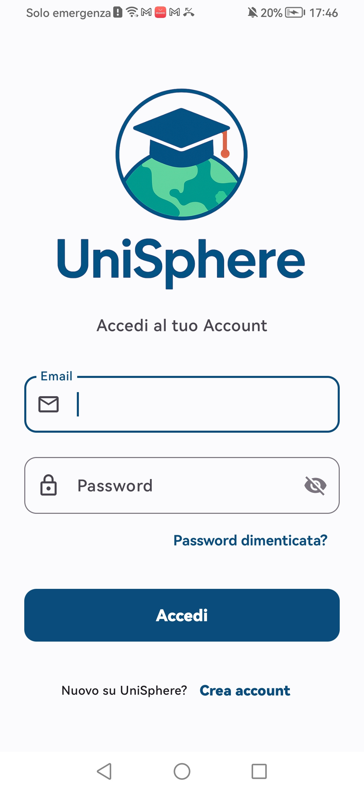
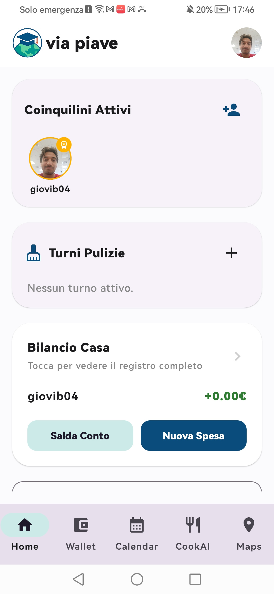
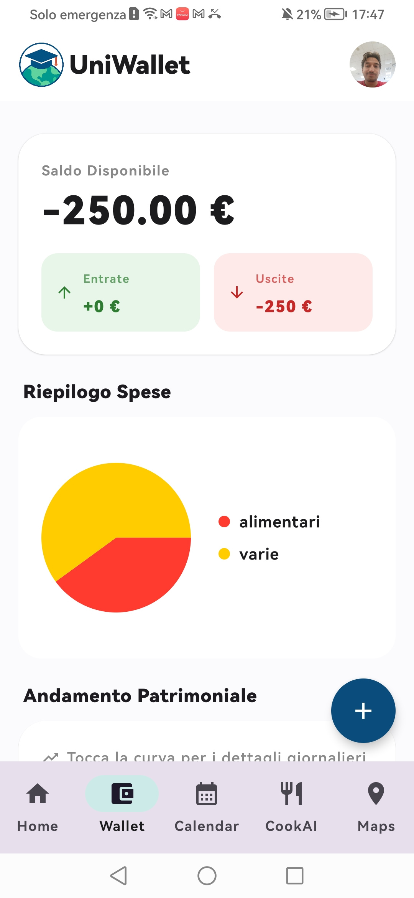
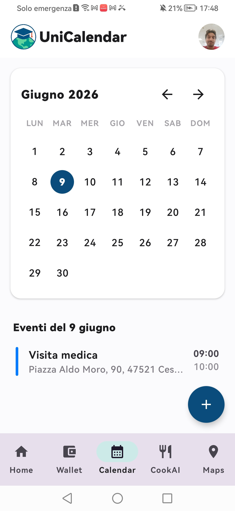
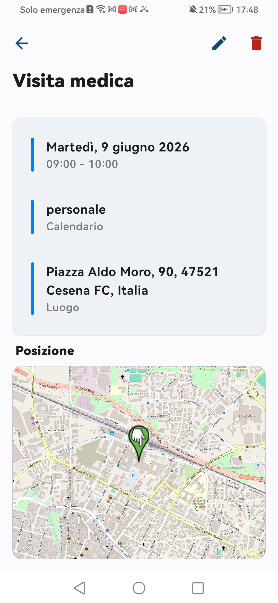
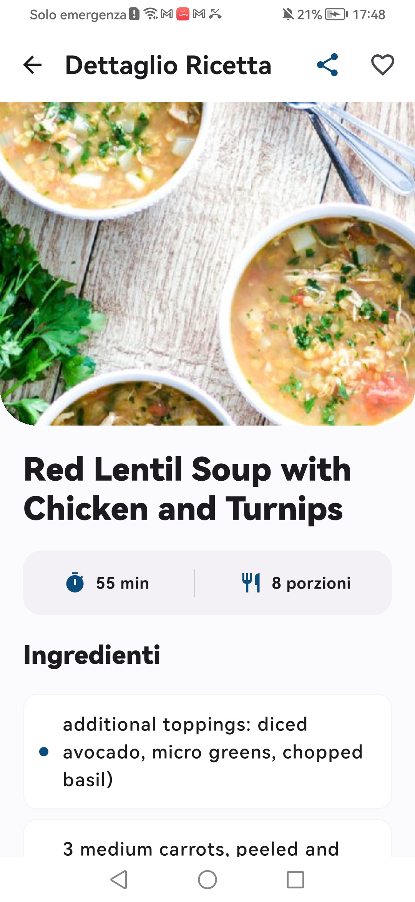

# UniSphere-App

UniSphere is an all-in-one Android app designed to help university students make the most of their university life. It brings together the tools students need to manage shared living, organize everyday commitments, keep track of expenses, and make student life simpler, more organized, and more enjoyable—all in one intuitive app.

##  Table of Contents

*   [ Features](#-features)
*   [ Tech Stack](#%EF%B8%8F-tech-stack)
*   [ Installation](#-installation)
*   [ Project Structure](#-project-structure)
*   [ API Reference](#-api-reference)
*   [ License](#-license)
*   [ Important Links](#-important-links)

##  Features

UniSphere-App offers a rich set of features to manage your daily life efficiently:

*   **User Authentication & Profile Management**:
    *   Secure user registration and login functionalities.
    *   Ability to update profile picture, username, and email.
    *   Personalize app theme (light, dark, system default).

*   **UniHome**:
    *   Create or join a shared house group with other users.
    *   Manage house members: invite new roommates and remove existing ones.
    *   Splitwise-like Shared Expenses: Add group expenses with custom splits among members, track who paid and who owes.
    *   Cleaning Rotation: Set up and track weekly cleaning services with assigned members and completion status.

*   **UniWallet**:
    *   Record and track personal incomes and expenses.
    *   Create and manage custom transaction categories.
    *   Get a real-time overview of net balance, total incomes, and total expenses.
    *   Advanced transaction filtering by type (income/expense), category, and amount range.

*   **UniCalendar**:
    *   Create, view, edit, and delete events with title, description, and time slots.
    *   Associate events with multiple customizable calendars.
    *   Location integration for events: manually input addresses, use current device location, or select from address suggestions.
    *   View event locations on an interactive OpenStreetMap (OSMDroid) within the event detail screen.

*   **UniMaps**:
    *   Save personal Points of Interest (POIs) with names, addresses, and optional notes.
    *   Display all saved POIs on an interactive OpenStreetMap (OSMDroid) map.
    *   Utilize current device location or search for addresses to define new POIs.
    *   Get quick directions to any saved POI using external map applications.

*   **UniChef**:
    *   Search for a vast array of recipes using the Spoonacular API.
    *   View comprehensive recipe details including ingredients, step-by-step instructions, preparation time, and servings.
    *   Mark and manage favorite recipes for quick access.
    *   Share delicious recipes with friends and family.
## Screenshots

<table>
  <tr>
     <td align="center">
      <strong>Login</strong><br>
      
    </td>
    <td align="center">
      <strong>UniHome</strong><br>
      
    </td>
    <td align="center">
      <strong>UniWallet</strong><br>
      
    </td>
  </tr>
  <tr>
     <td align="center">
      <strong>UniCalendar</strong><br>
      
    </td>
    <td align="center">
      <strong>UniMaps</strong><br>
      
    </td>
    <td align="center">
      <strong>UniChef</strong><br>
      
    </td>
    <td></td>
  </tr>
</table>


##  Tech Stack

UniSphere-App is built using modern and robust technologies:

*   **Primary Language**: Kotlin
*   **UI Framework**: Jetpack Compose
*   **Backend Communication**: Ktor Client
*   **Dependency Injection**: Dagger Hilt
*   **Serialization**: Kotlinx.serialization (JSON)
*   **Local Secure Storage**: EncryptedSharedPreferences (for JWT tokens)
*   **Mapping**: OSMDroid (OpenStreetMap library), Google Location Services
*   **Image Loading**: Coil
*   **External APIs**: Spoonacular API (for recipe data)
*   **Testing**: JUnit, AndroidJUnit4

## Installation

Getting started with UniSphere is simple!

1. Go to the [**Releases**](https://github.com/steppo04/Unisphere-App/releases) page.
2. Download the latest `unisphere.apk` file.
3. Open the downloaded APK on your Android device.
4. If prompted, allow your device to install apps from that source.
5. Complete the installation and open UniSphere.

**Requirements**
- An Android device running Android 8.0 (API 26) or later.
- An Internet connection to access online features.

##  Project Structure

The project follows a clean architecture pattern, organizing code into distinct layers for maintainability and scalability:

```
Unisphere-App/
├── app/
│   ├── build.gradle.kts
│   ├── proguard-rules.pro
│   └── src/
│       ├── androidTest/
│       ├── main/
│       │   ├── AndroidManifest.xml
│       │   ├── java/com/example/unisphere/
│       │   │   ├── Application.kt              
│       │   │   ├── MainActivity.kt              
│       │   │   ├── db/                        
│       │   │   │   ├── TokenManager.kt          
│       │   │   │   ├── dbUtils.kt               
│       │   │   │   ├── local/ApiClient.kt       
│       │   │   │   └── network/                 
│       │   │   │       
│       │   │   └── repository/                # Repository layer - API abstraction
│       │   │   |
│       │   │   └── ui/                        # User Interface layer - Jetpack Compose screens, viewmodels, etc.
│       │   │       ├── composables/           # Reusable UI components
│       │   │       ├── screen/                # Feature-specific screens and ViewModels
│       │   │       │   ├── accessScreen/        
│       │   │       │   ├── calendar/            
│       │   │       │   ├── cook/                
│       │   │       │   ├── map/                 
│       │   │       │   ├── profile/             
│       │   │       │   ├── uniHome/             
│       │   │       │   └── wallet/              
│       │   │       ├── theme/                   # App theming (colors, typography)
│       │   │       └── utils/ImageUtils.kt      # Utility for image selection
│       │   └── res/                         # Android resources (drawables, layouts, values, etc.)
│       └── test/
│           └── java/com/example/unisphere/ExampleUnitTest.kt
├── gradle/
├── .idea/
├── settings.gradle.kts
└── README.md
```

##  API Reference

UniSphere-App interacts with custom Ktor backend services and external APIs for its functionalities.

*   **Internal Ktor Backend API**: The application communicates with a dedicated backend hosted at `https://api.unisphere-db.it/`.
    *   All user-related data (authentication, profile), house management, wallet transactions, calendar events, and Points of Interest are managed through this backend.
    *   The API endpoints and data models (DTOs) are defined in `app/src/main/java/com/example/unisphere/db/network/` and utilized by the repository classes in `app/src/main/java/com/example/unisphere/repository/`.
    *   Authentication is handled via JWT tokens, securely stored using `EncryptedSharedPreferences` and automatically attached to requests by the Ktor HttpClient setup in `dbUtils.kt` and `ApiClient.kt`.

*   **Spoonacular API**: For recipe discovery and details, the app integrates with the Spoonacular API.
    *   Base URL: `https://api.spoonacular.com/recipes`
    *   An API key is required and currently hardcoded within `RecipeRepository.kt`.
    *   Endpoints used include `/complexSearch` for searching recipes and `/{id}/information` for fetching detailed recipe information.
    *   For more details, refer to the [Spoonacular API Documentation](https://spoonacular.com/api/docs).

## License
This project is licensed under the MIT License - see the [LICENSE](LICENSE) file for details.

## Important Links

*   **GitHub Repository**: [https://github.com/steppo04/Unisphere-App](https://github.com/steppo04/Unisphere-App)
*   **Backend API**: [https://api.unisphere-db.it/](https://api.unisphere-db.it/)
*   **Spoonacular API Documentation**: [https://spoonacular.com/api/docs](https://spoonacular.com/api/docs)
